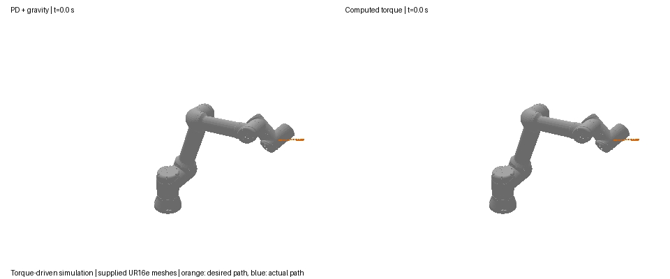
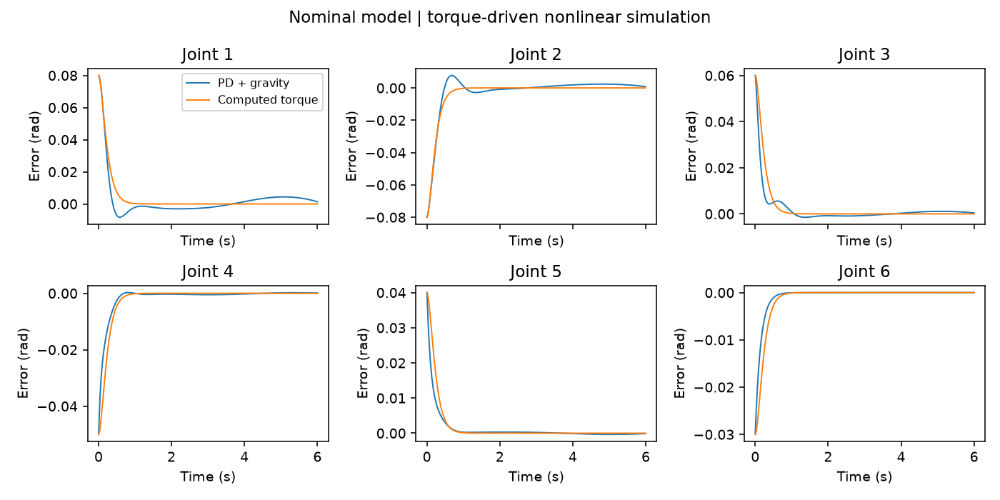

# UR16e Robot Dynamics and Control

Torque-driven simulation of a six-joint UR16e model, with checked kinematics,
rigid-body dynamics, PD-plus-gravity and computed-torque tracking, and a
secondary collision-checked planning example. Extended from the original
Shanghai Jiao Tong University Robotics team project.



*Actual simulated joint states, rendered with the supplied UR16e meshes. Both
controllers follow the same six-second joint reference under identical initial
conditions and torque bounds. Orange: desired end-effector path; blue: actual.
Executed with PyBullet in WSL; this is not Simulink or hardware footage.*

## Results

| Configuration | Aggregate joint RMS error (rad) | Maximum final joint error (rad) | Saturation |
|---|---:|---:|---:|
| PD + gravity, nominal | 0.008643 | 0.001370 | 0% |
| Computed torque, nominal | 0.009635 | 0.00000179 | 0% |
| PD + gravity, unmodeled 1 kg payload | 0.028008 | 0.050365 | 0% |
| Computed torque, unmodeled 1 kg payload | 0.186758 | 0.213234 | 0% |

Computed torque gives smaller nominal final error, but does not outperform PD
on every transient metric. Payload mismatch exposes large wrist errors. Gains
have different physical units; this is a comparison of declared configurations,
not a universal ranking. The report retains per-joint RMSE, peak errors, applied
torques, saturation, a timestep failure and convergence checks.



- **Kinematics:** imported URDF FK, geometric/finite-difference Jacobians and
  local numerical FK-IK consistency across reproducible sampled configurations.
- **Dynamics:** mass symmetry/positive definiteness, independent kinetic-energy
  mass and potential-gradient gravity checks, Christoffel bias, forward/inverse
  consistency and an applied-wrench sign test. Maximum independent mass residual
  6.22e-15; gravity residual 6.41e-9 Nm.
- **Tracking:** identical nonlinear plant, reference, initial offset, 0.25 ms
  integration, and declared URDF effort bounds. A half-step check changes joint
  states by at most 1.65e-4 rad across the four configurations.
- **Planning:** a secondary Python adaptation of the original RRT/shortcut
  logic succeeds for 3/3 seeds in a simple declared scene; smoothed edges are
  checked at finer spacing. Finite collision sampling is not a safety guarantee.

## Run

Linux/WSL, Python 3.11 and the dependencies in
[requirements-dynamics.txt](portfolio/requirements-dynamics.txt):

```bash
python3.11 -m venv .venv
.venv/bin/python -m pip install -r portfolio/requirements-dynamics.txt
.venv/bin/python portfolio/run_experiments.py --output outputs/my_main --dt 0.00025
.venv/bin/python portfolio/run_experiments.py --output outputs/my_half --dt 0.000125
.venv/bin/python portfolio/export_experiments.py --run outputs/my_main --half-step outputs/my_half
UR16E_RUN=outputs/my_main .venv/bin/python portfolio/test_executed.py
.venv/bin/python portfolio/planning_experiment.py --output outputs/my_planning
```

Use fresh run directories. Full trajectories, configurations and environment
records are exported alongside results; selected GIFs, plots, JSON and 20 ms
CSV traces are retained in [docs/executed](docs/executed).

## Coursework and extensions

Original group: **Yixiao Liu, Yusen Wu and Huaqian Zhao**. Original MATLAB/Simulink,
FK/IK, dynamics, RRT, URDF and meshes remain traceable; the archive is reconciled
without importing its nested Git repository or caches. New extensions include
URDF/frame reconciliation, corrected Coriolis/gravity/wrench conventions,
independent dynamics checks, executed tracking/payload experiments and mesh
animations. Replaced MATLAB routines are preserved in `baselines/`.

## Limitations

MATLAB/Simulink is unavailable on the execution host: the corrected MATLAB
sources are prepared but unexecuted; all new dynamic results use the identified
URDF-based PyBullet implementation. The embedded Simulink model is preserved.
Supplied inertials are approximate model data, not experimentally identified
manufacturer truth. Tracking disables contacts and friction; actuator bounds
are simulation assumptions taken from the URDF. No hardware, calibration,
real-time, global IK, continuous collision safety or general robustness claim.

[Technical report and reproduction details](docs/DYNAMICS_REPORT.md) ·
[Exact metrics](docs/executed/tracking_metrics.json) ·
[Model verification](docs/executed/half_step_verification.json) ·
[Historical source audit](docs/AUDIT.md)
