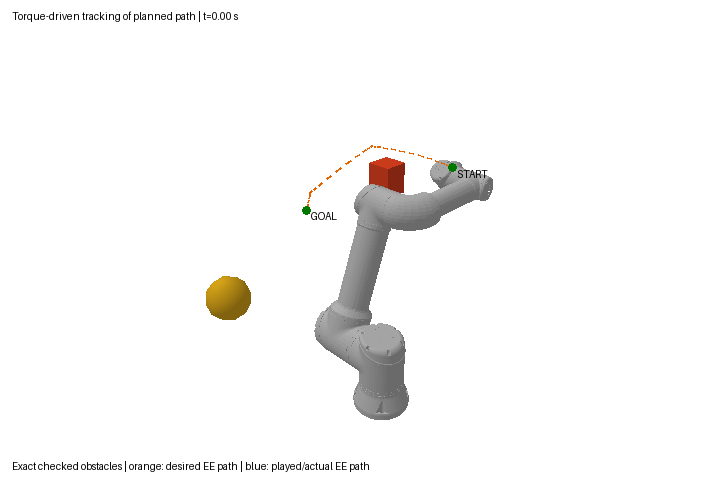

# UR16e Motion Planning and Control

**Project date:** Spring 2025

A runnable Python robotics project: import the supplied UR16e model, plan a
collision-checked joint path, time-parameterize it and execute it with a
nonlinear torque-driven controller. Includes independent model checks and
matched PD/computed-torque experiments from the original team coursework.



*Torque-driven tracking of an RRT-generated detour. The direct joint segment
hits the checked obstacle; the timed planned path and actual simulated motion
are validated separately. Simulated in PyBullet.*

## Implemented capabilities

- URDF/mesh loading; FK, geometric Jacobians and bounded numerical full-pose IK.
- Rigid-body mass, gravity, velocity terms, inverse/forward dynamics and wrench conventions.
- Joint reference generation, PD plus gravity and computed-torque control.
- Joint-space RRT, shortcut smoothing, edge checking and path-preserving C2 timing.
- Independent reference/actual collision and position/velocity/torque-limit checks.
- Reproducible numerical exports, plots and actual-mesh GIF/MP4 demonstrations.

Python is the primary implementation, using bounded numerical IK and
edge-preserving quintic timing.
[Feature mapping](docs/FEATURE_MAPPING.md) · [Python API and reproduction](docs/PYTHON_WORKFLOW.md)

## Planning to dynamic execution

Three fixed seeds found detours in the declared blocked-path scene. The first
seed's 7.02 s timed path was executed with computed torque and a small initial
state offset:

| Measure | Verified result |
|---|---:|
| Pooled joint/time RMS tracking error | **0.001179 rad** |
| Minimum sampled reference clearance | **18.349 mm** |
| Minimum sampled actual clearance | **18.349 mm** |
| Sampled collisions / refined invalid edges | **0 / 0** |
| Position / velocity / applied-torque violations | **0 / 0 / 0** |
| Maximum state difference at half timestep | **7.13e-6 rad** |

Clearance checks use 5 ms state samples and <=.005 rad interpolated edge checks;
selected nonadjacent self pairs are checked. Torque bounds are declared URDF simulation limits.
The three seeds cover one blocked-path scene; clearance is sampled rather than continuous.

[Exact metrics](docs/migration/metrics.json) · [Planning-only playback](docs/migration/planning.gif)

## Controller and payload comparison

These are separate six-second matched tracking experiments without obstacles.
Pooled RMS is the square root of mean squared error over **all joints and state
samples**, including the initial offset; it is not a mean of per-joint RMSEs.

| Configuration | Pooled RMS error (rad) | Maximum final joint error (rad) |
|---|---:|---:|
| PD + gravity, nominal | 0.008643 | 0.001370 |
| Computed torque, nominal | 0.009635 | 0.00000179 |
| PD + gravity, unmodeled 1 kg payload | 0.028008 | 0.050365 |
| Computed torque, unmodeled 1 kg payload | 0.186758 | 0.213234 |

Computed torque gives smaller nominal final error; PD has lower pooled transient RMSE in this configuration. The unmodeled payload increases errors, particularly for computed torque
with these gains. See the report for controller equations and payload modeling.


[Additional demonstrations on the project page](https://yixiaoliu.me/projects/ur16e-motion-planning-control/)

## Quick start

Linux/WSL Python 3.11; ffmpeg is needed for MP4 export:

```bash
python3.11 -m venv .venv
.venv/bin/python -m pip install -r portfolio/requirements-dynamics.txt
.venv/bin/python portfolio/cli.py kinematics --output outputs/my_kinematics
.venv/bin/python portfolio/cli.py compare --output outputs/my_comparison
.venv/bin/python portfolio/cli.py plan-track --output outputs/my_plan
.venv/bin/python portfolio/cli.py visualize --run outputs/my_plan
.venv/bin/python portfolio/cli.py verify --run outputs/my_comparison
```

Choose fresh output directories. [Full commands](docs/PYTHON_WORKFLOW.md#simple-commands)
include payload-only execution, timestep convergence and additional plots/videos.

## About the project

Developed from Shanghai Jiao Tong University Robotics coursework. The Python
implementation integrates URDF/frame reconciliation, dynamics corrections,
independent checks, planning/control experiments and mesh-based visualization.
Original MATLAB/Simulink sources are preserved in [legacy](legacy/README.md).

## Model checks

Independent kinetic/potential-energy dynamics agree with the engine: maximum
mass residual 6.22e-15 and gravity residual 6.41e-9 Nm. Jacobians, local IK,
external-wrench signs, forward/inverse consistency and timestep convergence are
checked. The executed Python simulations use a fixed base, supplied inertials, disabled contact response,
and selected self-collision pairs; settings are detailed in the workflow report.

[Integrated workflow report](docs/PYTHON_WORKFLOW.md) ·
[Full dynamics report and failures](docs/DYNAMICS_REPORT.md) ·
[Legacy model notes](docs/AUDIT.md)
