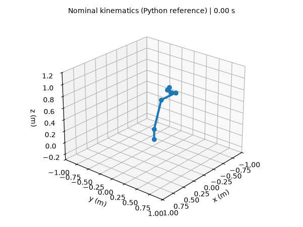
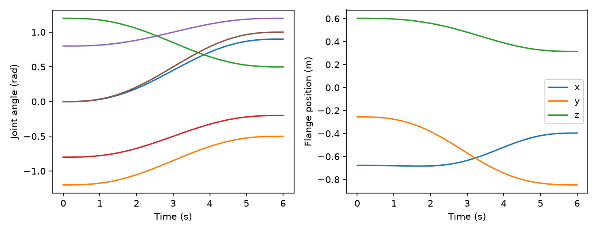

# UR16e Nominal Kinematics and Dynamics Audit

A Robotics (Spring 2025) team project, extended with an explicit nominal UR16e
kinematics demo and an audit of the original MATLAB/Simulink dynamics and planning
code. Primary implementation: MATLAB. Original sources remain unchanged.



*Actual computed standard-DH configurations over a 6 s smooth joint path. This
checked-in animation is an independent Python reference, not a MATLAB/Simulink
run, hardware recording or collision-free-motion demonstration.*

## Capabilities and measured checks

- Nominal base-to-flange FK and geometric Jacobian, in metres/radians.
- A toolbox-free MATLAB joint-motion demo with CSV, verification JSON and GIF export.
- Independent numerical verification: 50 configurations, 300 Jacobian columns,
  maximum central-difference residual **1.30e-10** (h=1e-6).
- Computed 121-sample path: **0.75117 m** sampled flange distance over 6 s.
  This is prescribed joint motion, not trajectory tracking.



[Numerical results](docs/results/verification.json) · [Sampled trajectory](docs/results/reference_trajectory.csv)

## Run

From the root in MATLAB (new demo targets base MATLAB R2023b+):

```matlab
addpath('portfolio');
run_demo('outputs/matlab_demo_01'); % fresh directory required
```

MATLAB is unavailable on the verification host: this entry point is prepared but
**not execution-verified**. Independent reference reproduction requires Python
3.12 with NumPy, SciPy, Matplotlib and Pillow:

```powershell
python -m pip install -r portfolio/requirements-reference.txt
python portfolio/verify_reference.py
```

The original Simulink files identify R2025a. Legacy scripts require additional
toolboxes and path setup; see [audit and dependency details](docs/AUDIT.md).
No Simulink execution, dynamic accuracy or tracking-error result is claimed.

## Coursework and extensions

Original team: **Yixiao Liu, Yusen Wu and Huaqian Zhao**. Existing work includes
modified-DH symbolic FK/analytic IK, standard-DH Jacobian/dynamics routines,
RRT/B-spline helpers, control live scripts and Simulink/URDF models. Their
presence does not establish successful end-to-end operation. Supplied-versus-
student authorship is unresolved for some helpers; no sole-authorship claim.

New `portfolio/` files isolate standard-DH SI conventions, remove the symbolic
dependency for the focused example, compute a geometric Jacobian and export
motion and verification results. Nominal geometry is attributed to the
[Universal Robots parameter table](https://www.universal-robots.com/articles/ur/application-installation/dh-parameters-for-calculations-of-kinematics-and-dynamics).

## Limitations

Legacy modified/standard-DH mismatch, Coriolis shape/argument errors, gravity and
wrench sign inconsistencies, and planner helper limitations are documented in
[the audit](docs/AUDIT.md). They are preserved for traceability, not advertised
as validated dynamics or collision avoidance. No verified analytic IK,
manufacturer calibration accuracy, payload dynamics, hardware deployment or
controller performance is claimed. MATLAB/Simulink execution remains pending.

[Original README](docs/ORIGINAL_README.md) · [Original inventory](docs/ORIGINAL_INVENTORY.json)
