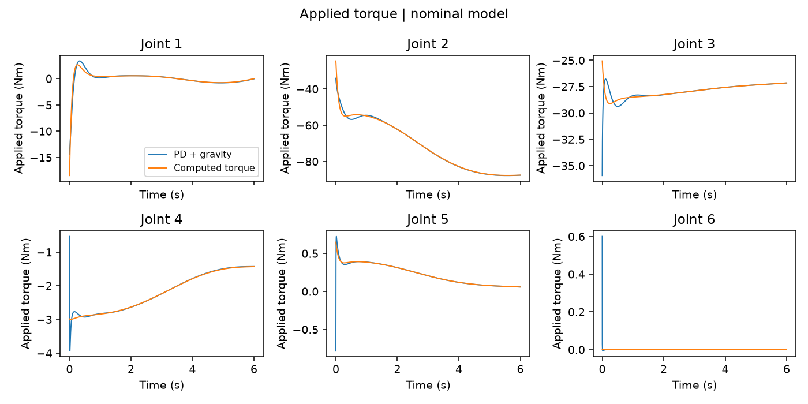
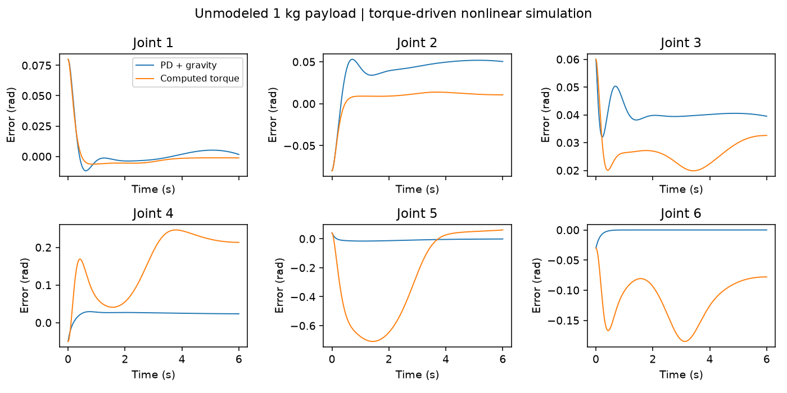

# UR16e dynamics, tracking and planning experiments

The current primary entry point and integrated obstacle-avoidance execution are
documented in [Python workflow](PYTHON_WORKFLOW.md). MATLAB/Simulink files named
below now live under `legacy/`; pre-repair copies are under `legacy/baselines/`.
The original URDF/meshes remain at root `simulink/`. Results in this report are
preserved; the new blocked-path experiment is a separate measured scenario.

Executed 2026-10-24 in the existing WSL2 installation, Python 3.11.15 and
PyBullet 3.2.7. MATLAB/Simulink was unavailable on this host. Original model metadata identifies
R2025a; that route requires Robotics System Toolbox, Simulink and model-dependent
Simscape/Multibody. The experiments below use the URDF-based Python implementation.

## Source model and archive

The supplied archive SHA-256 and a safe-file inventory are recorded in
[archive_reconciliation.json](executed/archive_reconciliation.json). It has
72 non-cache/non-metadata files considered here: 46 exact repository matches,
66 matches after newline normalization against the retained original sources.
The source URDF is semantically identical despite byte-level differences.
The extra standalone URDF, course report, datasheet, meshes RAR and 48 MB STEP
were inspected as archive inputs, not bulk-imported. The STEP header identifies
AP214, SolidWorks 2020 and a 2024 export. The report text describes alternate DH tables and earlier numerical
IK/dynamics comparisons; those historical claims are not substituted for
present execution. No nested `.git`, slprj, slxc or macOS files were imported.

The original report identifies a Shanghai Jiao Tong University Robotics team
project by **Yixiao Liu, Yusen Wu and Huaqian Zhao**, supervised by Ding Ye.
Existing FK/IK, dynamics, RRT, live scripts, Simulink models and
URDF/meshes remain traceable. New work comprises model reconciliation, dynamics
repairs, the independent URDF energy reference, executed experiments, portable
RRT adaptation, tests and mesh-based result rendering.

## Model, frames and parameters

The source `simulink/UR16e.urdf` remains unchanged. A generated local copy
resolves `package://ur_description/` to the supplied mesh directory, converts
existing DAE visuals to OBJ for Bullet, and explicitly sets massless fixed
helper frames to zero inertia so the engine does not insert default inertials.
No link masses or inertias of the six physical moving links are altered in
the nominal model. `URDF_USE_INERTIA_FROM_FILE` is enabled. Damping and default
joint motors are disabled; fixed base and no contacts are used for tracking.
The same original visual and collision meshes are used, including shared
UR10e meshes referenced by the supplied UR16e description. No substitute
stick model or STEP-derived dynamics is used for the main animation.

Joint order is shoulder_pan, shoulder_lift, elbow, wrist_1, wrist_2, wrist_3.
Angles are radians, lengths metres, torques Nm. The controller `base` frame is
Rz(pi) from URDF `base_link`. Standard-DH frame 6 equals `tool0` when expressed
in `base`. URDF `flange` has a separate fixed orientation; its origin coincides
with tool0 but it is not interchangeable for orientation/wrench coordinates.
Standard DH uses no joint offsets. The original modified-DH FK with q2/q4
offsets is retained, not mixed into this model. No calibrated TCP is added.

The nominal DH dimensions agree with the
[UR parameter table](https://www.universal-robots.com/articles/ur/application-installation/dh-parameters-for-calculations-of-kinematics-and-dynamics).
The supplied URDF inertia model is not assumed to be experimentally identified
manufacturer truth. Its masses match the hand-coded table, but COMs and inertia
frames differ. For example, URDF shoulder COM is at its link origin, while
the old code used [0,−.016,.030] m in a DH frame. Upper-arm COM becomes
[.2392, approximately 0, .175] m in DH coordinates rather than [.302,0,.160].
The wrist-3 URDF COM transforms to −.025 m along DH z, versus the old −.044.
Rotating each URDF inertia through its inertial-origin and link-to-DH rotation
produces [reconciled_parameters.json](executed/reconciled_parameters.json).
Tests verify the resulting DH mass matrix against the URDF energy model at
five additional configurations; tolerance 1e−8. Merely comparing raw tensor
entries without changing frames would be misleading.

## Dynamics repairs and independent checks

Original MATLAB files are copied byte-for-byte into `baselines/mydynamics/`;
the old import script is retained under `baselines/simulink/`. The corrected
`mydynamics` routines now share the URDF-derived DH-frame inertials:

- `compute_coriolis(q,q_dot,masses,I_links)` returns a 6×6 Christoffel matrix
  from central differences of M, rather than broadcasting a 6-vector into a
  6×6 array. Forward/inverse callers use the corrected argument order.
- Gravity is the compensation term `G = dU/dq`, with positive g=9.81 and
  `U=sum(m*g*z)`. Downward physical gravity is not mistaken for compensation.
- COM Jacobians and rotated COM inertias share the same standard-DH frames.
- External wrench is force ON the robot, at frame-6/tool0 origin, expressed
  in the UR `base` frame, ordered [force; moment]. The convention is
  `M*ddq + C*dq + G = tau + J'*w`; inverse dynamics subtracts J'*w and
  forward dynamics adds it. Fixed-orientation transforms must be applied if
  a caller supplies a flange-frame wrench.
- `simulink/import_urdf.m` uses its own directory and an explicit MeshPath
  instead of a current-folder-dependent search and global path mutation.

These MATLAB source repairs were reviewed but **not executed in MATLAB**.
The Python reference independently builds FK/COM Jacobians from URDF XML,
forms M from translational/rotational kinetic energy, obtains G from potential
energy derivatives, and contracts Christoffel derivatives for C*dq. This is
compared to Bullet's articulated-body mass matrix and recursive inverse
dynamics, not just a same-model forward/inverse round trip. The engine API
conventions follow the [official Bullet guide](https://github.com/bulletphysics/bullet3/blob/master/docs/pybullet_quickstart_guide/PyBulletQuickstartGuide.md.html).

20 reproducible configurations use NumPy seed 5170. Max absolute residuals:

| Check | Result |
|---|---:|
| Independent FK vs imported URDF position | 3.56e−8 m |
| Independent FK vs imported URDF rotation | 2.77e−7 rad |
| DH vs reconciled URDF pose entries | 3.44e−10 |
| Geometric Jacobian vs Bullet | 5.55e−16 |
| Jacobian vs central finite differences | 1.66e−10 |
| Mass matrix asymmetry | 0 |
| Smallest sampled mass eigenvalue | 8.94e−4 |
| Energy-reference mass matrix vs Bullet | 6.22e−15 |
| Potential-gradient gravity vs Bullet | 6.41e−9 Nm |
| Independent C*dq+G vs Bullet | 6.38e−9 Nm |
| Near-target numerical IK position residual | 4.25e−12 m |
| Near-target numerical IK orientation residual | 1.36e−13 rad |
| Inverse torque vs measured forward-step acceleration | 4.43e−11 rad/s² |
| Applied external wrench vs M⁻¹Jᵀw acceleration | 4.34e−13 rad/s² |

Bullet link-pose reporting is less precise than its internal dynamics. The IK
test uses SciPy full-pose least squares with perturbed initial guesses, not
the legacy analytic solver; it demonstrates local consistency, not global IK
coverage or guaranteed convergence. The 1 μs single-step checks disable damping
and contacts. Sampled positive definiteness is not an exhaustive proof.
The executed external-wrench test expresses J and the applied wrench in
`base_link`/engine world coordinates; the MATLAB convention above uses UR base.
Rotating both spatial quantities consistently gives the same joint torque.

## Matched tracking protocol

Six-second quintic rest-to-rest joint interpolation:
q0=[0,−1.2,1.2,−.8,.8,0], q1=[.9,−.5,.5,−.2,1.2,1]. Both controllers start
at q0+[.08,−.08,.06,−.05,.04,−.03], zero velocity. Commands update at every
0.25 ms semi-implicit Euler step on the identical nonlinear plant. No contacts,
friction, sensor noise or velocity enforcement is modeled. Applied motor torques
are clipped to [330,330,150,56,56,56] Nm from the supplied URDF effort fields;
these are declared simulation bounds, not independently verified ratings.

PD+gravity: `tau=Kp*(qd−q)+Kd*(dqd−dq)+G_nom(q)` with Kp=[180,180,120,50,30,20]
Nm/rad and Kd=[30,35,22,8,5,3] Nm·s/rad. Computed torque uses
`tau=ID_nom(q,dq,ddqd+64*(qd−q)+16*(dqd−dq))`. Gains have different units;
matching their numbers would not make them equivalent. They were fixed across
nominal and payload cases, and were not tuned to force computed torque to win.
RMSE includes all state samples and the common initial error. Peak error and
saturation use absolute values and applied inputs as appropriate.

Nominal per-joint results (radians; peak torque Nm):

| Joint | PD RMSE | CT RMSE | Common peak error | PD peak torque | CT peak torque |
|---|---:|---:|---:|---:|---:|
| 1 | .012609 | .012907 | .080 | 14.400 | 18.454 |
| 2 | .013141 | .012907 | .080 | 87.786 | 87.717 |
| 3 | .007208 | .009680 | .060 | 35.940 | 29.112 |
| 4 | .005727 | .008067 | .050 | 3.936 | 2.998 |
| 5 | .004533 | .006454 | .040 | .784 | .649 |
| 6 | .003356 | .004840 | .030 | .600 | .00183 |

All nominal/payload saturation fractions are zero. Nominal aggregate RMS over
all joints/time is .008643 rad for PD and .009635 rad for computed torque.
Computed torque has a smaller maximum final joint error (1.79e−6 versus
1.37e−3 rad), but does not improve transient RMSE on every joint.




### Payload mismatch and numerical failure

Add a 1 kg point-body payload at tool0, with .001 kg·m² diagonal rotational
inertia; both controllers retain nominal parameters. PD aggregate RMS becomes
.028008 rad; computed torque becomes .186758 rad. The latter's joint-5 peak
error is .70877 rad. This exposes model sensitivity of this configuration,
not universal superiority of PD. Full per-joint RMSE, peak errors, torques,
saturation and final errors for all four cases remain in
[tracking_metrics.json](executed/tracking_metrics.json).



The initial 1 ms run produced a stiff-wrist PD numerical failure (joint-6
RMSE 1.4323 rad, saturation 96.95%). It is preserved locally and summarized in
`initial_1ms_tracking_metrics.json`; it is not presented as a controller-quality
comparison. Reducing both controllers' step to .25 ms without changing gains
removed it. Halving again to .125 ms changes states by at most 5.72e−5 rad
in PD cases and 1.65e−4 rad in payload CT. See
[convergence.json](executed/convergence.json). This supports the selected step
for these runs, not general numerical stability.

The main animation renders the supplied UR16e meshes at states generated by
the torque-driven simulation; orange is the desired end-effector path and blue
is actual. The older stick animation in `docs/results/` is **kinematic playback**
and remains separately labeled. No Simulink or hardware footage is implied.

## Secondary planning experiment

Because MATLAB is unavailable, a small Python adaptation reuses the original
RRT joint-extension and shortcut-smoothing ideas with Bullet collision queries;
it is not execution of the original MATLAB RRT. It fixes zero-distance
extension handling and validates every edge, then revalidates shortcuts at a
finer spacing. Three seeds 5170/5171/5172 succeeded (3/3) in the explicitly
declared new box/sphere scene: planning times .0080/.0064/.0045 s, raw path
lengths 2.7273/2.6554/2.4673 rad; smoothed lengths all 1.81934 rad. All
smoothed edges passed .01 rad sampling (planning .04 rad). The direct segment
is valid in this scene, so this is a simple reproducibility check, not a hard
obstacle-navigation benchmark. Timing excludes shortcut smoothing and the
finer independent check. [Settings/results](executed/planning.json) and
[numerical paths](executed/planning_paths.json) are retained.

An earlier scene put the goal inside a box: 0/3 with explicit invalid-endpoint
status, preserved in `planning_invalid_goal.json`. That is not solver failure
or physical infeasibility. Selected nonadjacent link pairs are checked; adjacent
and fixed helper pairs are excluded. Convex collision representations and finite
edge sampling do not certify continuous clearance or full self-collision safety.

## Reproduce

Use Linux/WSL Python 3.11. The persistent environment on the experiment host is
`/home/yxlewis/.venvs/ur16e`.

```bash
# From the repository root in the existing WSL installation:
/home/yxlewis/.venvs/ur16e/bin/python3.11 -m pip install -r portfolio/requirements-dynamics.txt
/home/yxlewis/.venvs/ur16e/bin/python3.11 portfolio/run_experiments.py --output outputs/reproduce_main --dt 0.00025
/home/yxlewis/.venvs/ur16e/bin/python3.11 portfolio/run_experiments.py --output outputs/reproduce_half --dt 0.000125
/home/yxlewis/.venvs/ur16e/bin/python3.11 portfolio/export_experiments.py --run outputs/reproduce_main --half-step outputs/reproduce_half
UR16E_RUN=outputs/reproduce_main /home/yxlewis/.venvs/ur16e/bin/python3.11 portfolio/test_executed.py
/home/yxlewis/.venvs/ur16e/bin/python3.11 portfolio/planning_experiment.py --output outputs/reproduce_planning
```

On another Linux machine, create a fresh persistent environment with
`python3.11 -m venv .venv` and substitute `.venv/bin/python` above. Fresh run
directories are required. Curated exports intentionally update `docs/executed`;
full-resolution NPZ/CSV trajectories and resolved meshes stay in ignored outputs.
Review-sized 20 ms CSV traces, exact metrics, configuration and environment are
versioned. Four tests check recorded independent-dynamics residuals, transformed
DH inertias, finite-difference Jacobians and independently recomputed saved
metrics/actuator bounds.

For a licensed MATLAB installation, use `addpath('legacy/mydynamics')` explicitly;
avoid `genpath` because retained baseline functions intentionally share names.
The earlier base-MATLAB kinematics demo remains available separately. Repaired
MATLAB dynamics and the original Simulink controller still need a licensed run;
the embedded Simulink dynamics were not automatically replaced by `.m` repairs.

## Remaining limitations

Supplied inertials are approximate model data; no friction, drive electronics,
thermal behavior, calibration error, collisions during tracking or hardware
validation is modeled. Payload is one declared perturbation. Controller gains differ, one nominal trajectory is tested, and the initial
planning scene has a valid direct path. The separate blocked-path experiment
is documented in the Python workflow report. Original archives and STEP
are not required to rerun the URDF experiments because the relevant original
URDF and meshes already exist in Git.
